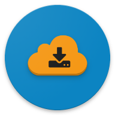

<!-- HEADER_START -->
#  1DM

**🎯 Supported versions:** `20.0 (30257)`

`idm.internet.download.manager`
<!-- HEADER_END -->

## Features

| Feature | What you get |
|---|---|
| 🚫 **Remove ads (1DM)** | Removes the banners, full-screen ads and the prompts that offer a reward for watching one |
| 🚫 **Remove 1DM+ promotions** | The "Install 1DM+" banner at the bottom, the "Install Shoppers Search" button and the offer strip under the tabs are gone |
| 🎨 **Rename to IDM+** *(off by default)* | The app shows as IDM+ in the launcher and everywhere inside the app. The package name is unchanged |

## How-to

### Open the Loki Patches menu

- **Navigation drawer** (the three lines at the top left) → **Loki Patches**, at the bottom.
- Long press the 1DM icon on your home screen → **Loki Patches**.

### Notes

- The free 1DM and the paid 1DM+ are separate builds, not a switch inside one app. The 16-part and 5-download limits, the
  scheduler and the proxy stay as in the free app; this bundle removes advertising and upsells only.
- The drawer's old "Upgrade to 1DM+" row becomes the Loki Patches row.
- Use the universal APKM from APKMirror (all ABIs).

## Patches

<!-- PATCHES_START -->
<!-- PATCHES_END -->
