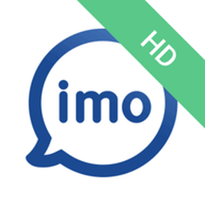

<!-- HEADER_START -->
#  IMO HD

**🎯 Supported versions:** `2026.10.1048`

`com.imo.android.imoimhd`
<!-- HEADER_END -->

## Features

| Feature | What you get |
|---|---|
| 🚫 **Remove ads (IMO)** | Removes IMO's ads: the opening ad, ads in chats and stories, the ad after a call, and the offer to pay to go ad-free |
| 📸 **Allow screenshots (IMO)** | Screenshots and screen recording work everywhere, including protected chat media and profile photos |
| 📞 **Allow story recording during calls (IMO)** | Record and post a story while on a call |
| 📎 **Allow sending apps (IMO)** | Adds the Apps option to the chat attachment menu |
| 🔥 **Disappearing messages (IMO)** | Turns on IMO's own disappearing-message option when you send (off by default; IMO's servers decide if the other person gets it) |
| 🧹 **Hide Premium on Me page (IMO)** | Removes the paid Premium Member entry (off by default) |
| 🙈 **Hide emoji suggestions (IMO)** | Removes the row of emojis above the chat box, where one tap sends the emoji straight away |
| 🙈 **Hide voice rooms tab (IMO)** | Removes the voice rooms tab (Room and Explore) from the top bar, leaving Chats and Contacts |
| 🔑 **Spoof signature (IMO)** | Makes IMO accept the patched app, so the sign-in code arrives and notifications keep working |

## How-to

### Open the Loki Patches menu

- **Me** page (your photo, top left) → the **Loki Patches** row, right under Settings.
- Long press the IMO icon on your home screen → **Loki Patches**.

### Notes

- Use the APKM from APKMirror: IMO ships as a bundle of several files and Manager joins them for you.
- **Spoof signature** is applied together with every other IMO patch. Without it a patched IMO runs but never asks for your sign-in code.
- Only 64-bit phones are covered by the signature patch. Almost every phone from the last several years is 64-bit.
- If the text message does not arrive, choose the **call** option on the sign-in screen. IMO offers both.
- Premium Member (badge, 25 GB cloud storage, visitor history, rebate) is set by IMO's servers, so a patch cannot give it to you. Remove ads works because IMO decides that on your phone.
- IMO already has its own privacy settings for read receipts, typing status and last seen: **Me → Settings → Security & Privacy**.

## Patches

<!-- PATCHES_START -->
<!-- PATCHES_END -->
